# Closeout workflow flowchart

This diagram maps all 55 step IDs in [workflow.yml](./workflow.yml). The dark Start circle marks entry; rectangles are prompts, diamonds are switches, the hexagon is the bounded loop, parallelograms are human gates, and rounded nodes are commands. Dashed outlines mark delegated steps. Approval display labels preserve the original human choices.

```mermaid
flowchart TD
    start((Start))
    n000["assess-closeout-readiness<br/>(FarmBoy Reviewer)"]
    n001@{ shape: diam, label: "route-initial-closeout" }
    n002["prepare-closeout-status"]
    n003@{ shape: diam, label: "route-closeout-status" }
    n004(["mark-converged-specification-complete<br/>(FarmBoy Specifier)<br/>command: speckit.specify"])
    n005["assess-implemented-lifecycle-milestone<br/>(FarmBoy Code Reviewer)"]
    n006{{"closeout-lifecycle-recovery-loop<br/>condition: {{ steps.route-closeout-lifecycle-edge.output.state == 'continue' }}<br/>max_iterations: 3"}}
    n007["assess-closeout-lifecycle-edge<br/>(FarmBoy Reviewer)"]
    n049@{ shape: diam, label: "route-closeout-recovery-evidence" }
    n050(["assess-recovery-roadmap-brief<br/>(FarmBoy Roadmap Agent)<br/>command: speckit.flow-roadmap.brief"])
    n051["assess-recovery-preparation<br/>(FarmBoy Reviewer)"]
    n052["record-recovery-preparation"]
    n053["assess-recovery-readiness<br/>(FarmBoy Readiness Checker)"]
    n055["attest-recovery-start<br/>(FarmBoy Reviewer)"]
    n008["prepare-closeout-lifecycle-request"]
    n009["prepare-closeout-lifecycle-transition"]
    n010@{ shape: diam, label: "route-closeout-lifecycle-transition" }
    n011["revalidate-closeout-lifecycle-transition"]
    n012@{ shape: diam, label: "route-closeout-lifecycle-revalidation" }
    n013(["apply-closeout-lifecycle-transition<br/>(FarmBoy Roadmap Agent)<br/>command: speckit.flow-roadmap.write"])
    n014["verify-closeout-lifecycle-transition<br/>(FarmBoy Reviewer)"]
    n015["verify-closeout-lifecycle-noop-after-revalidation<br/>(FarmBoy Reviewer)"]
    n016["verify-existing-closeout-lifecycle-state<br/>(FarmBoy Reviewer)"]
    n017["route-closeout-lifecycle-edge"]
    n018["verify-implemented-lifecycle-before-debrief"]
    n019@{ shape: diam, label: "route-implemented-lifecycle-before-debrief" }
    n020{{"closeout-debrief-loop<br/>condition: {{ steps.assess-closeout-debrief.output.state == 'continue' }}<br/>max_iterations: 6"}}
    n021(["debrief-roadmap<br/>(FarmBoy Reviewer)<br/>command: speckit.flow-roadmap.debrief"])
    n022["assess-closeout-debrief<br/>(FarmBoy Code Reviewer)"]
    n023@{ shape: diam, label: "route-closeout-correction" }
    n024["prepare-closeout-flowback"]
    n025@{ shape: diam, label: "route-closeout-specification-remediation" }
    n026(["reconcile-closeout-specification<br/>(FarmBoy Specifier)<br/>command: speckit.specify"])
    n027@{ shape: diam, label: "route-closeout-plan-remediation" }
    n028(["reconcile-closeout-plan<br/>(FarmBoy Planner)<br/>command: speckit.plan"])
    n029@{ shape: diam, label: "route-closeout-tasks-remediation" }
    n030(["reconcile-closeout-tasks<br/>(FarmBoy Tasker)<br/>command: speckit.tasks"])
    n031(["analyze-closeout-artifacts<br/>(FarmBoy Reviewer)<br/>command: speckit.analyze"])
    n032["assess-closeout-task-eligibility<br/>(FarmBoy Reviewer)"]
    n033@{ shape: diam, label: "route-closeout-implementation" }
    n034(["implement-closeout-eligible-tasks<br/>(FarmBoy Coder)<br/>command: speckit.implement"])
    n035["prepare-roadmap-verification"]
    n036@{ shape: diam, label: "route-roadmap-verification" }
    n037[/"approve-roadmap-transition"/]
    n038@{ shape: diam, label: "route-roadmap-transition" }
    n039(["apply-approved-roadmap-verification<br/>command: speckit.flow-roadmap.write"])
    n040["prepare-wiki-maintenance<br/>(FarmBoy Roadmap Agent)"]
    n041@{ shape: diam, label: "route-wiki-maintenance" }
    n042{{"wiki-reconciliation-loop<br/>condition: {{ steps.assess-wiki-maintenance.output.state == 'continue' }}<br/>max_iterations: 5"}}
    n043["prepare-wiki-refresh"]
    n044(["ingest-curated-context<br/>(FarmBoy Wiki Curator)<br/>command: speckit.flow-wiki.ingest"])
    n045(["lint-wiki<br/>(FarmBoy Reviewer)<br/>command: speckit.flow-wiki.lint"])
    n046["assess-wiki-maintenance<br/>(FarmBoy Reviewer)"]
    n047["verify-closeout-readiness<br/>(FarmBoy Reviewer)"]
    n048["report-closeout-outcome"]
    start --> n000
    n047 --> n048
    n046 --> n042
    n045 --> n046
    n044 --> n045
    n043 --> n044
    n042 -- first pass --> n043
    n042 -- condition false / cap --> n047
    n041 -- ready --> n042
    n041 -- blocked --> n048
    n040 --> n041
    n039 --> n040
    n038 -- approved --> n039
    n038 -- not-approved --> n040
    n037 --> n038
    n036 -- patch-ready --> n037
    n036 -- already-verified --> n040
    n036 -- blocked --> n040
    n035 --> n036
    n034 --> n020
    n033 -- continue --> n034
    n033 -- complete --> n020
    n033 -- blocked --> n020
    n032 --> n033
    n031 --> n032
    n030 --> n031
    n029 -- run --> n030
    n029 -- skip --> n031
    n028 --> n029
    n027 -- run --> n028
    n027 -- skip --> n029
    n026 --> n027
    n025 -- run --> n026
    n025 -- skip --> n027
    n024 --> n025
    n023 -- continue --> n024
    n023 -- complete --> n020
    n023 -- blocked --> n020
    n022 --> n023
    n021 --> n022
    n020 -- first pass --> n021
    n020 -- condition false / cap --> n035
    n019 -- verified --> n020
    n019 -- blocked --> n035
    n019 -- question --> n035
    n018 --> n019
    n017 --> n006
    n014 --> n017
    n013 --> n014
    n012 -- ready --> n013
    n015 --> n017
    n012 -- no-op --> n015
    n012 -- blocked --> n017
    n012 -- question --> n017
    n011 --> n012
    n010 -- ready --> n011
    n016 --> n017
    n010 -- no-op --> n016
    n010 -- blocked --> n017
    n010 -- question --> n017
    n009 --> n010
    n008 --> n009
    n055 --> n008
    n053 --> n055
    n052 --> n053
    n051 --> n052
    n050 --> n051
    n049 -- recovery --> n050
    n049 -- normal --> n008
    n049 -- blocked --> n048
    n007 --> n049
    n006 -- first pass --> n007
    n006 -- condition false / cap --> n018
    n005 --> n006
    n004 --> n005
    n003 -- run --> n004
    n003 -- skip --> n005
    n002 --> n003
    n001 -- continue --> n002
    n001 -- complete --> n035
    n001 -- blocked --> n035
    n000 --> n001
    style start fill:#111827,stroke:#111827,color:#ffffff
    class n000,n004,n005,n007,n013,n014,n015,n016,n021,n022,n026,n028,n030,n031,n032,n034,n040,n044,n045,n046,n047,n050,n051,n053,n055 delegated
    classDef delegated fill:#eef2ff,stroke:#4f46e5,stroke-dasharray:6 4
```

Initial readiness can stop without a loop output, or use current trusted already-verified evidence. Otherwise a clear Draft-to-Complete update precedes the fresh debrief loop. Every loop pass starts with debrief; the first assessment establishes a baseline, subsequent corrections require a resolved prior finding. Six checks allow five corrections plus a final confirmation. Only `continue` enters the shared specification → plan → tasks waterfall; fresh analysis precedes eligible implementation.

An eligibility `complete` result means no eligible implementation work and returns to a fresh debrief. `blocked` eligibility and unresolved implementation blockers stop directly at the shared report under the [controller protocol](../../controllers/farmboy/controller-protocol.md), before another debrief. The controller checks progress, evidence, and the cap before entering corrections. Explicit controller stop edges show this declared runtime policy in addition to ordinary YAML branch joins; native CLI execution does not establish these controller guarantees.

Outcome preparation uses only completed initial or loop evidence. An exact verification patch requires human approval, then a fresh roadmap check. Returning or deferring preserves the original choice and skips maintenance. Newly verified and already-verified features both enter shared wiki ingestion and lint checks. Wiki maintenance has its own sibling five-pass loop: select one authorized source, ingest, lint, and assess. Baseline gaps identify individual missing contracts or stale claims; resolving one prior claim permits continuation while other claims from that source remain. The ingestion child receives the exact correction checklist alongside its single source argument. Initial curation includes feature-relevant registered local supporting sources inside the operator-issued scope without extra confirmation. Verified claim-and-citation revalidation may update freshness metadata without a separate permission prompt and earns zero substantive progress credit. Do not treat timestamps or successful commands as progress. Stale pages map through citations to sources. Conflicting authority, unverified date-only warnings, unavailable or unauthorized sources, unsupported repairs, scope expansion, no progress, and cap exhaustion block. Only the latest validated complete maintenance assessment permits a readiness recommendation. The final report presents verified commit readiness automatically; only the exact roadmap-patch gate requires human approval, and an actual commit requires a subsequent explicit operator request; this workflow never commits, integrates Git, invokes another workflow, or accepts the feature. Partial approved changes are preserved and reported when later steps fail.

FarmBoy Code Reviewer uses an attributable implementation delta and returns exact review findings separately from the strict envelope. FarmBoy Coder receives those findings through eligible existing task correction. Fresh review confirms resolution; absent a safe eligible route, the workflow reports a specific blocked recovery. Product questions retain operator ownership.
