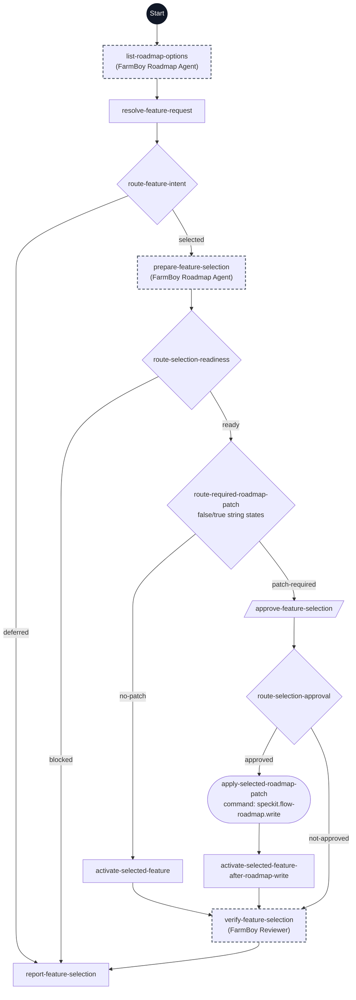

# Select Active Feature flowchart

This diagram maps every step ID in [workflow.yml](./workflow.yml) to its execution path. The dark Start circle marks entry; rectangles are prompts, diamonds are switches, parallelograms are human gates, and rounded nodes are commands. Dashed outlines indicate delegated steps.

The main task uses the typed resolver on a direct, unambiguous operator target without asking for a repeated choice. Missing or ambiguous intent prompts one focused selection question; dependency questions remain separate. A no-patch route proceeds to pointer activation, while any nonempty patch retains explicit approval. Pointer snapshots distinguish absent from present and carry a digest for revalidation. Activation preserves lifecycle and existing specification bytes and creates no feature directory or spec. Specify remains a separate operator invocation.
