# Implement Eligible Work flowchart

This diagram maps every step ID in [workflow.yml](./workflow.yml) to the bounded execution path. The dark Start circle marks entry; the hexagon is the five-pass continuation loop, rounded nodes are commands, diamonds are switches, and rectangles are prompts. Dashed outlines indicate delegated steps.

```mermaid
flowchart TD
    start((Start))
    n000["establish-implementation-scope"]
    n001["assess-implementation-state<br/>(FlowKit-Reviewer)"]
    n002["capture-implementation-baseline"]
    n003["assess-readiness-before-core"]
    n004["check-readiness-before-core<br/>(FlowKit-Readiness Checker)"]
    n005["gate-readiness-before-core"]
    n006["assess-implementation-start-milestone<br/>(FlowKit-Reviewer)"]
    n007["prepare-implementation-start-milestone"]
    n008@{ shape: diam, label: "route-implementation-start-milestone" }
    n009["revalidate-implementation-start-milestone"]
    n010@{ shape: diam, label: "route-implementation-start-revalidation" }
    n011(["apply-implementation-start-milestone<br/>(FlowKit-Roadmap Agent)<br/>command: speckit.flow-roadmap.write"])
    n012["verify-implementation-start-milestone<br/>(FlowKit-Reviewer)"]
    n013["verify-existing-implementation-start-state-after-revalidation<br/>(FlowKit-Reviewer)"]
    n014["verify-existing-implementation-start-state<br/>(FlowKit-Reviewer)"]
    n015["verify-lifecycle-and-readiness-before-coding"]
    n016@{ shape: diam, label: "route-readiness-before-core" }
    n017{{"implementation-loop<br/>condition: {{ steps.route-scoped-execution.output.state == &quot;continue&quot; }}<br/>max_iterations: 5"}}
    n018["route-scoped-entry"]
    n019@{ shape: diam, label: "prepare-scoped-prerequisites" }
    n020["record-preparation-session-start"]
    n021(["run-scoped-preparation<br/>(FlowKit-Coder)<br/>command: speckit.implement"])
    n022["record-preparation-session-outcome"]
    n023@{ shape: diam, label: "implement-tasks" }
    n024["record-source-session-and-attempt"]
    n025(["run-scoped-source-implementation<br/>(FlowKit-Coder)<br/>command: speckit.implement"])
    n026["record-source-session-outcome"]
    n027["assess-implementation-after-pass<br/>(FlowKit-Code Reviewer)"]
    n028@{ shape: diam, label: "route-post-assessment" }
    n029@{ shape: diam, label: "route-task-revision" }
    n030["preflight-task-revision-snapshot"]
    n031@{ shape: diam, label: "route-task-revision-preflight" }
    n032["prepare-task-revision"]
    n033["freeze-task-revision-scope"]
    n034["revalidate-task-revision-snapshot"]
    n035@{ shape: diam, label: "route-task-revision-snapshot" }
    n036(["revise-task-plan<br/>(FlowKit-Tasker)<br/>command: speckit.tasks"])
    n037["review-task-revision-scope"]
    n038["validate-task-revision"]
    n039@{ shape: diam, label: "route-task-revision-result" }
    n040["advance-progress-after-task-revision"]
    n041@{ shape: diam, label: "route-progress-tasker-transition" }
    n042["stop-progress-tasker-transition"]
    n043["stop-task-revision-result-blocked"]
    n044["stop-task-revision-dispatch-blocked"]
    n045["stop-task-revision-dispatch-unrecognized"]
    n046["stop-task-revision-preflight-blocked"]
    n047["stop-task-revision-preflight-unrecognized"]
    n048["preflight-reviewed-task-tracking"]
    n049(["track-reviewed-task-outcomes<br/>(FlowKit-Tasker)<br/>command: speckit.tasks"])
    n050["validate-reviewed-task-tracking"]
    n051["reassess-readiness-before-reentry"]
    n052["check-readiness-before-reentry<br/>(FlowKit-Readiness Checker)"]
    n053["gate-readiness-before-reentry"]
    n054@{ shape: diam, label: "route-readiness-before-reentry" }
    n055["route-scoped-execution"]
    n056["stop-readiness-before-reentry"]
    n057["stop-readiness-before-reentry-unrecognized"]
    n058(["track-reviewed-completion<br/>(FlowKit-Tasker)<br/>command: speckit.tasks"])
    n059["validate-reviewed-completion-tracking"]
    n060["stop-readiness-before-core"]
    n061["stop-readiness-before-core-unrecognized"]
    n062["report-implementation-outcome"]
    start --> n000
    n055 --> n017
    n054 -- ready --> n028
    n056 --> n055
    n054 -- blocked --> n056
    n057 --> n055
    n054 -- default --> n057
    n053 --> n054
    n052 --> n053
    n051 --> n052
    n050 --> n051
    n049 --> n050
    n048 --> n049
    n029 -- existing-task --> n048
    n041 -- ready --> n048
    n042 --> n048
    n041 -- blocked --> n042
    n040 --> n041
    n039 -- ready --> n040
    n043 --> n048
    n039 -- blocked --> n043
    n039 -- default --> n048
    n038 --> n039
    n037 --> n038
    n036 --> n037
    n035 -- ready --> n036
    n044 --> n048
    n035 -- blocked --> n044
    n045 --> n048
    n035 -- default --> n045
    n034 --> n035
    n033 --> n034
    n032 --> n033
    n031 -- ready --> n032
    n046 --> n048
    n031 -- blocked --> n046
    n047 --> n048
    n031 -- default --> n047
    n030 --> n031
    n029 -- revise --> n030
    n028 -- work-remains --> n029
    n059 --> n055
    n058 --> n059
    n028 -- complete --> n058
    n028 -- blocked --> n055
    n027 --> n028
    n026 --> n027
    n025 --> n026
    n024 --> n025
    n023 -- implement-tasks --> n024
    n023 -- default --> n027
    n022 --> n023
    n021 --> n022
    n020 --> n021
    n019 -- prepare-scoped-prerequisites --> n020
    n019 -- default --> n023
    n018 --> n019
    n017 -- first pass --> n018
    n017 -- condition false / cap --> n062
    n016 -- ready --> n017
    n060 --> n062
    n016 -- blocked --> n060
    n061 --> n062
    n016 -- default --> n061
    n015 --> n016
    n012 --> n015
    n011 --> n012
    n010 -- ready --> n011
    n013 --> n015
    n010 -- no-op --> n013
    n010 -- blocked --> n015
    n010 -- question --> n015
    n009 --> n010
    n008 -- ready --> n009
    n014 --> n015
    n008 -- no-op --> n014
    n008 -- blocked --> n015
    n008 -- question --> n015
    n007 --> n008
    n006 --> n007
    n005 --> n006
    n004 --> n005
    n003 --> n004
    n002 --> n003
    n001 --> n002
    n000 --> n001
    style start fill:#111827,stroke:#111827,color:#ffffff
    class n001,n004,n006,n011,n012,n013,n014,n021,n025,n027,n036,n049,n052,n058 delegated
    classDef delegated fill:#eef2ff,stroke:#4f46e5,stroke-dasharray:6 4
```

The six-node `implementation_scope` carrier is valid only on `implementation-loop` in `speckit-flow-implement`. It contains the scoped entry, preparation branch, source branch, independent Code Reviewer assessment, post-assessment route, and final nondelegated scoped route. Its exact five-pass condition continues only when `route-scoped-execution` returns `continue`; that final route checks fresh readiness, no progress, and the shared session/attempt limits before returning. The trusted full-feature or exact subset request and all unfinished IDs are frozen before initial assessment; requested IDs remain separate from current eligibility. The controller keeps session and attempt history in consumer-local state and persists each start event before dispatch. A preparation session shares the same nonresetting five-session budget as source work; failed dispatches and questions count, and same-child answers do not consume another session. Readiness/authority failures before a dispatch do not fabricate a session event.

Before the first source attempt, the scope route may choose only preparation or first-source work. Administrative completion can update accounting but earns no implementation progress. After any source attempt, the final route supplies the actual previous/current substantive assessments to the unchanged generic prior-remaining/resolved predicate, no-progress guard, and cap. Tasker owns ordinary task-marker updates and exact finding-linked task revisions; all current scope, eligibility, readiness, owner-source access, assignments, and activation evidence are revalidated before another effect. A blocked or missing gate exits before another Coder pass; the final report preserves the exact blocker and safe resumption.

`task_revision_action` is the separate string enum `skip` or `revise`; only `revise` reaches the exact declared FlowKit-Tasker via core `speckit.tasks`, with no routine reopening approval. Before reading task bytes, the installed helper checks active identity, lexical paths and parents, symlinks, and physical containment, then freezes task/specification text and digests. An adjacent installed-helper call repeats identity and digest checks immediately before Tasker. After Tasker, a separate main-controller semantic check binds the changed tasks to the selected feature's frozen approved specification scope. The deterministic validator checks exact finding/task mappings, owner assignments, scope digest, path safety, and preservation of unrelated task history through the installed consumer helper. A ready revision makes tasks eligible for the next Coder pass but earns zero implementation progress and does not resolve findings. Only fresh independent review can confirm resolution. Out-of-scope changes, unsafe diffs, stale evidence, unavailable assignment, repeated findings, no progress, and the five-pass cap remain explicit stops. Task revision does not invoke FlowKit Tasks or another workflow.

Before coding, `capture-implementation-baseline` freezes selected task/finding identities, owners and current source evidence. Fresh Code Reviewer assessment validates closure through the installed `implementation-progress` helper. Resolving a prior defect permits bounded continuation while its parent task remains open; the main controller carries the validated next baseline and retains every original pass record. New findings alone, omitted/renamed IDs and task-marker edits do not earn credit. Readiness, no-progress, authority and cap stops still apply.

The Tasker ready path also runs `advance-progress-after-task-revision` then `route-progress-tasker-transition`; a blocked transition terminates at `stop-progress-tasker-transition` before reentry. It preserves the independently pending task obligation and original finding history even when a valid Tasker correction extends the task description.
